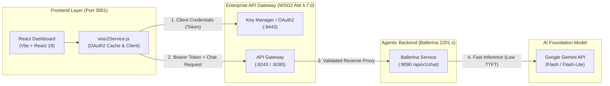

# Enterprise Agentic AI Workflow Automator

An enterprise-ready, secure, and observable AI Agent orchestration platform combining **Ballerina microservices**, **WSO2 API Manager (OAuth2 Gateway)**, **Google Gemini Generative AI**, and a responsive **React (Vite)** dashboard.

---

## 🏛️ System Architecture



---

## 🚀 Core Functionalities

### 1. Enterprise-Grade API Security & Governance (WSO2 API Manager)
* **OAuth2 Authentication**: All client interactions require Bearer tokens issued via the OAuth2 **Client Credentials** grant type.
* **Token Caching & Lifecycle Management**: Client-side automatic token caching with pre-expiration renewal (30-second buffer) preventing redundant token requests.
* **Enterprise Control Plane**: Full visibility and traffic control via WSO2 Publisher and DevPortal (`https://localhost:9443/publisher`, `https://localhost:9443/devportal`).
* **Rate Limiting & Threat Protection**: Built-in enterprise throttling, DDoS prevention, and TLS encryption.

### 2. High-Performance Agentic Microservice (Ballerina)
* **Cloud-Native Integration**: Built on Ballerina Swan Lake (`2201.13.4`), optimized for network interactions, concurrency, and observability.
* **Direct Google Gemini API Integration**: Direct integration with Gemini models (`gemini-3.1-flash-lite` / `gemini-2.5-flash`) via native HTTP client.
* **Optimized TTFT (Time-to-First-Token)**: Pre-configured with zero thinking budget (`thinkingBudget: 0`) to achieve real-time response speeds.
* **Resilient Error Handling**: Defensive JSON mapping and upstream error trapping to prevent microservice crashes during upstream failures.
* **Unified Payload Contract**: Normalizes upstream Gemini nested payload into clean API output (`{ "status": "success", "agent_reply": "..." }`).

### 3. Interactive Conversational Dashboard (React + Vite)
* **Real-Time Natural Language Interaction**: Responsive chat interface for submitting business prompts and viewing formatted agent responses.
* **Vite Development Proxy**: Seamlessly proxies OAuth token generation (`/wso2-token` -> `:9443`) and chat queries (`/wso2-gateway` -> `:8243`) bypassing CORS and self-signed certificate issues during local development.
* **Modular Extensibility**: Ready for embedding enterprise components (task schedulers, approval cards, workflow status widgets).

---

## 📁 Repository Structure

```
.
├── README.md                                  # Root documentation (this file)
├── enterprise_automator/                      # Ballerina Backend & Gateway setup
│   ├── Ballerina.toml                         # Ballerina package configuration & dependencies
│   ├── Config.toml                            # Runtime config (Gemini API keys)
│   ├── Dependencies.toml                      # Auto-resolved Ballerina modules
│   ├── docker-compose.yml                     # WSO2 API Manager 4.7.0 container spec
│   ├── main.bal                               # HTTP Service exposing /api/v1/chat
│   ├── .env                                   # WSO2 endpoint and credentials config
│   └── wso2-data/                             # Persistent H2/shared database storage
└── enterprise_automator Frontend/
    └── my-react-app/                          # React + Vite Frontend
        ├── index.html                         # Application entrypoint HTML
        ├── package.json                       # Frontend dependencies & scripts
        ├── vite.config.js                     # Vite proxy configurations for WSO2
        ├── .env                               # VITE_WSO2_CONSUMER_KEY & SECRET
        └── src/
            ├── App.jsx                        # Application root component
            ├── components/
            │   └── AgentDashboard.jsx         # Conversational AI Dashboard
            └── services/
                └── wso2Service.js             # OAuth2 token manager & API client
```

---

## 🛠️ Prerequisites & Setup Guide

### 1. Prerequisites
* **Docker Desktop**: For running WSO2 API Manager.
* **Ballerina Swan Lake**: (v2201.13.0+ or compatible Swan Lake release).
* **Node.js**: (v18.x or v20.x+) and `npm`.
* **Google Gemini API Key**: Obtainable from [Google AI Studio](https://aistudio.google.com/).

---

### 2. Step-by-Step Setup

#### Step 1: Start WSO2 API Manager
From the backend directory:
```bash
cd "enterprise_automator"
docker-compose up -d
```
* Management Console / Carbon: `https://localhost:9443/carbon`
* Publisher: `https://localhost:9443/publisher`
* DevPortal: `https://localhost:9443/devportal`

*(Default credentials: `admin` / `admin`)*

#### Step 2: Configure & Run Ballerina Backend
1. Update `enterprise_automator/Config.toml` with your Gemini API key:
   ```toml
   geminiApiKey = "YOUR_GEMINI_API_KEY"
   ```
2. Start the Ballerina service:
   ```bash
   cd "enterprise_automator"
   bal run
   ```
   The backend service starts listening on `http://localhost:9090`.

#### Step 3: Configure & Run React Frontend
1. Navigate to the frontend directory:
   ```bash
   cd "enterprise_automator Frontend/my-react-app"
   ```
2. Ensure `.env` has your WSO2 Application credentials:
   ```env
   VITE_WSO2_CONSUMER_KEY="your_wso2_consumer_key"
   VITE_WSO2_CONSUMER_SECRET="your_wso2_consumer_secret"
   ```
3. Install dependencies and start Vite dev server:
   ```bash
   npm install
   npm run dev
   ```
4. Access the dashboard at `http://localhost:3001`.

---

## 📡 API Reference

### Backend Direct Endpoint
* **URL**: `POST http://localhost:9090/api/v1/chat`
* **Headers**: `Content-Type: application/json`
* **Request Payload**:
  ```json
  {
    "user_message": "Plan an automated weekly reporting workflow."
  }
  ```
* **Response Payload**:
  ```json
  {
    "status": "success",
    "agent_reply": "Here is the proposed workflow..."
  }
  ```

### Gateway Secured Endpoint
* **URL**: `POST https://localhost:8243/agent/v1/1.0.0/api/v1/chat`
* **Headers**:
  * `Authorization`: `Bearer <OAUTH2_ACCESS_TOKEN>`
  * `Content-Type`: `application/json`

---

## 🔒 Security Best Practices
* Do **not** commit `Config.toml` or `.env` files containing live credentials to version control.
* In production, configure WSO2 API Manager with production database instances (e.g., MySQL / PostgreSQL) instead of local H2 storage.
* Always enforce HTTPS and validate TLS certificates outside development.
